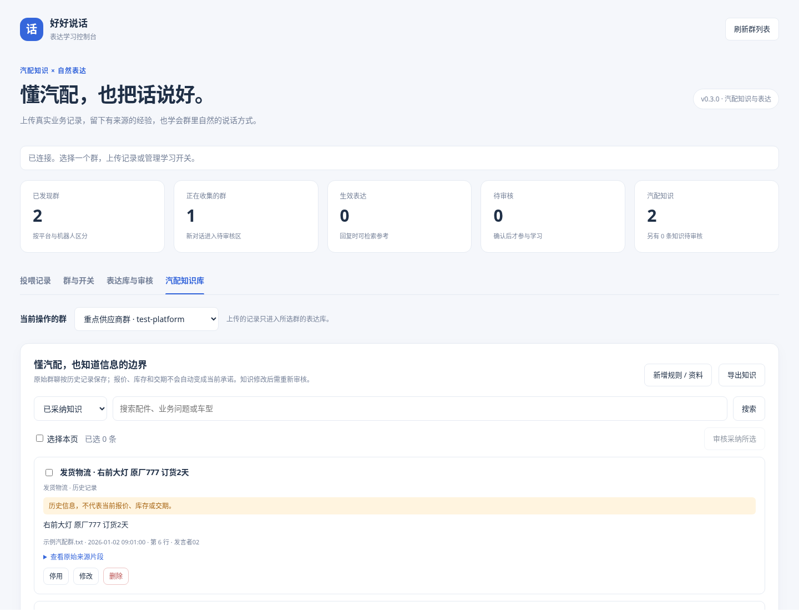

# 工作环境学习（0.4.2）

[返回插件说明](../README.md) · [群聊格式示例](../examples/auto_parts_chat.txt) · [知识 JSON 模板](../examples/auto_parts_knowledge.json)

“教它怎么说话”学习自然表达；“熟悉工作环境”学习怎样理解汽配群中的需求。两套数据分别检索，再交给 AstrBot 原来配置的模型生成回复，不修改 DeepSeek 的参数。



## 学什么

| 分类 | 例子 | 需要核对 |
| --- | --- | --- |
| 术语与别名 | 机盖 / 发动机盖 / 引擎盖、叶子板 / 翼子板 | 语境是否一致，不混淆位置和结构 |
| 部件区别 | 倒车镜总成、镜片与外壳；灯具总成与灯壳 | 不能把子件与总成合并，不把内后视镜视为外后视镜 |
| 工作流程 | 询价补信息 → 双方确认品项 → 跟进发货 → 售后 | 询价、报价、确认、发货是不同状态 |
| 场景沟通规则 | “原厂的呢”补充品质要求；“划线的”依赖图片 | 缺上下文就追问，不猜测部件或替商家承诺 |

具体报价、某次库存、某次交期、订单、客户电话和车架号不作为原始群聊的长期环境知识。各群的约定分别保存，不会把某群的交易条件套到另一群。

## 投喂与确认

1. 更新到 v0.4.2 并刷新 AstrBot，打开“插件可视化视图 → 表达学习控制台”。
2. 选目标群，在“投喂记录”点击 **② 熟悉工作环境**。
3. 多选文件，或选择 / 拖入整个文件夹（含子目录）。先检查清单，可取消勾选或移出文件；此时文件还在浏览器，不上传、不解析、不学习。
4. 点击 **预览所选文件**，检查每个文件的预览状态、右侧前 5 条概念与总数。解析失败文件会排除，不混入最终确认。传错可清空或更换。
5. 点击 **确认学习环境知识**，再在弹窗中核对群名、入口、文件名和条数后确认。
6. 打开 **工作环境知识库 → 待审核知识**，逐条核对或批量采纳。候选不会自动参与回复；编辑后重新待审。

每个文件最多 2 MiB、2000 个概念；每批最多 50 个文件、20 MiB、10000 条记录。预览保留 15 分钟，未确认的预览不持久保存。开启“从这个群学习”后，新消息同样只产生待审候选；不会自动学习机器人自己的输出。

## 支持的原始格式

UTF-8 TXT，每条消息以日期时间、发言人开头，例如虚构记录：

```text
示例汽配群

2026-01-02 09:00:00 示例买家
机盖也叫发动机盖吗？要的是倒车镜总成。

2026-01-02 09:01:00 示例供应商
倒车镜要分清总成、镜片和外壳，先核对车型配置。
```

解析会分离导出中的引用块，只从新发言提取概念。图片、语音、系统占位符不等于附件内容，不能补出未保存的信息。

## 提取方法与限制

本版采用规则，不额外调用外部模型：

- 常见部件、品质与流程用语命中预设行业词表后，生成相应解释候选。词表解释是插件提供的参考，不是聊天本身证实的事实。
- 明确写出的“甲也叫乙”“甲又叫乙”“甲不是乙”等关系，可形成新的名称关系候选。名字共同出现不会自动建立别名关系，问句中的关系也需要人工核实。
- 候选只保留概念、最少用语证据、来源行号和观察时间，不保留原始交易正文与发言者身份。数字与身份不会被用于拼接车型、价格和订单。
- 重复观察相同概念不会反复累加同一条知识，也不会提高它的可信度；只有审核后的条目才供模型参考。

隐含的新别名、复杂新业务流程或其他软件导出格式可能无法识别，不能保证自动理解每条聊天。可以直接新增环境资料，或用 JSON 模板补充。例如：

```json
[
  {
    "title": "气门室盖的称呼",
    "content": "在本群已核对的语境中，气门室盖也称摇臂室盖；仍应核对车型与具体结构。",
    "category": "术语与别名",
    "kind": "reference"
  }
]
```

整理好的 JSON / JSONL 支持 reference（环境参考）与 rule（管理员确认的本群沟通约定）。不要放交易金额、客户信息或一次交易的条件；常见交易数字会被拒绝。TXT/Markdown 走概念提取，不把整篇原文分块存档。

## 审核、检索与旧版本数据

审核前请检查：两个名字是否确实同义、总成与子件是否混淆、规则是否仅适用于这个群。可以编辑、停用、删除、设置有效期或导出；修改后重新审核。已采纳表示人工审核状态，不保证车型适配结论正确。

“知识查询试验”只检索当前群已审核、未过期的环境知识，不调用模型。自然表达和环境知识的使用开关独立，不改变原有 DeepSeek 提供商或模型。

0.3.0 已有的 history 交易片段不删除，仍可查看和导出，**即使已采纳也不再参与检索**。新版不再生成或导入此类型；重新投喂原始记录可提取环境概念。

本插件不是实时业务数据接口或 VIN/OEM 适配数据库。被检索的内容会发送给 AstrBot 中配置的模型；JSON、手工录入及表达样例应自行检查隐私。分享安装包只包含程序与虚构示例。
