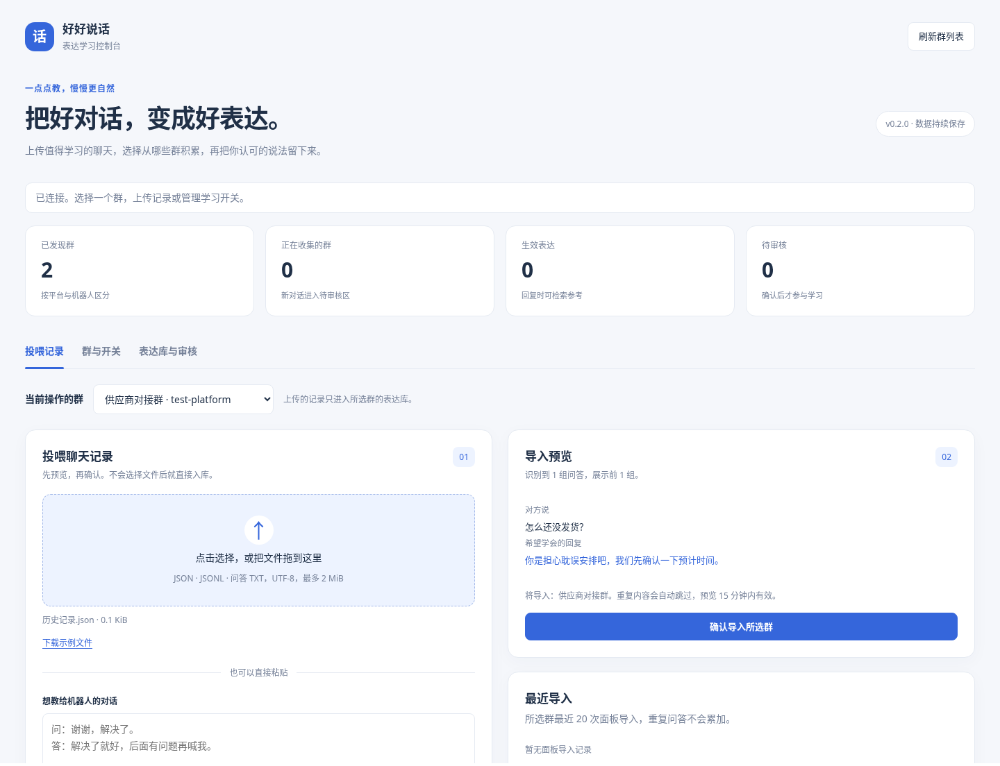
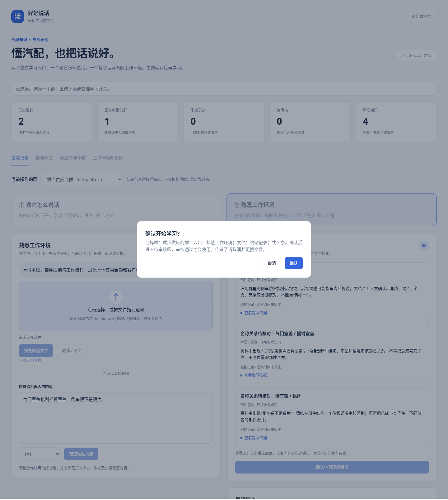

# 表达学习控制台

[返回插件说明](../README.md) · [记录文件示例](../examples/dialogues.json) · [群内命令](learning.md)

## 从哪里打开

1. 在 AstrBot 的“插件”页面，更新“好好说话 · 表达学习”到 **0.4.1** 并启用。
2. 重新加载插件，然后刷新浏览器。
3. 在左侧 **“插件可视化视图”** 中点击 **“表达学习控制台”**。如果尚未显示，先进入一次插件页面，再刷新浏览器。

也可以保持现有 AstrBot 的域名和端口，将浏览器地址后面的页面路径改为 `/plugin-view/astrbot_plugin_human_style/learning`。仍需登录 AstrBot，且插件必须已更新并启用。

面板在你已有的 AstrBot 网页里使用，不用找运行目录，不用操作服务器文件夹，也不用额外登录。



上图使用测试群展示界面，实际群列表来自你自己的机器人。

## 1. 两个学习入口，确认后才学习

- **① 教它怎么说话：**上传整理好的优质问答，学习措辞、情绪回应和语气。支持 UTF-8 JSON / JSONL / 问答 TXT，最多 2 MiB、2000 组；问题最多 500 字符，回复最多 1000 字符。
- **② 熟悉工作环境：**上传带日期时间及发言人的汽配群聊 TXT，识别术语别名、部件区别、业务流程与场景规则。也支持 TXT/Markdown 概念提取及整理好的知识 JSON。详见[工作环境学习指南](auto-parts-knowledge.md)。

操作顺序：

1. 选好“当前操作的群”和学习入口。
2. 选择或拖入文件。此时仅显示文件名，**尚未上传**；传错点“取消 / 清空”或重新选择。
3. 点击 **“预览所选文件”**，在右侧检查提取结果。也可以粘贴内容后点击“预览粘贴内容”。预览不写入学习库。
4. 点击 **“确认学习环境知识”** 或 **“确认学习表达方式”**。
5. 在弹窗核对 **群名、入口、文件名、条数**，点击确认；点取消则不写入。
6. 环境知识还要在 **“工作环境知识库 → 待审核知识”** 中审核后才参与回复。表达问答是你认可的训练样例，最终确认后可供参考。



预览只显示前 5 条并注明总数，有效期 15 分钟。环境库可逐条修改、审核或删除；改变文件、粘贴内容、格式、目标群或入口会清除旧预览。预览过期、跨群或跨管理账号的确认会被拒绝，重复点击不会重复导入。

两个入口有各自示例文件。表达入口可直接粘贴：

```text
问：谢谢，解决了。
答：解决了就好，后面有问题再喊我。
```

环境入口可粘贴明确的术语知识，例如：

```text
气门室盖也叫摇臂室盖。
倒车镜不是镜片。
```

别名关系先成为候选，需核对部件结构与上下文；不能因为两个词同时出现就认定是同一个东西。

## 2. 决定从哪些群学习

点击 **“群与开关”**，每个群有三个独立开关：

| 开关 | 开启后 | 关闭后 |
| --- | --- | --- |
| 从这个群学习 | 收集后续群聊表达及环境概念候选，等待审核 | 停止收集新候选，保留已有表达 |
| 在这个群使用自然表达 | 回复时启用自然语气规则并参考该群表达库 | 不再注入表达规则；知识开关开启时仍可参考业务知识 |
| 使用环境知识 | 参考当前群已审核、未过期的知识及业务核对提示 | 不向模型追加本插件的知识上下文 |

表达和知识开关独立：关闭自然表达不会同时关闭业务知识；两个都关闭后不再注入这两类上下文。

点击开关即保存，不用再去群里发命令。新安装默认关闭自动收集；旧版本已有设置继续沿用。手动上传资料不要求开启群聊收集。

**“备注”** 可以给一长串群编号起一个易认的名字。备注只影响面板显示，不改变真实群名。

OneBot 支持同步群列表；QQ 官方等平台未提供统一群列表时，展示插件接收过消息的群。群没出现就让该群发一条机器人能收到的消息，再点击 **“刷新群列表”**。平台可能不提供群名，可使用备注。显示列表不保证完整，也不保证历史群当前仍有机器人在内。

如果显示“受插件总开关或群白名单限制”，请到插件配置启用插件，或调整生效群白名单。面板开关不会绕过这些设置。

## 3. 审核和修改表达

点击 **“表达库与审核”**，先选目标群，再选择状态：

- **生效表达：**模型回复时可以检索参考。可以修改、评分或删除。
- **待审核候选：**从群聊收集而来，还不影响回复。确认合适后点击“通过并学习”，也可以先修改。
- **已停用：**权重降到 -2 后不再参考的记录，可以查看、修改或删除；修改本身不会重新启用它。

搜索框可按问题或回复文字查找，列表支持翻页。“更值得参考 +1”和“减少参考 −1”会影响检索排序，权重最多为 10。

**“导出生效问答”** 可以把所选群的生效样例保存为 JSON，之后可在另一个目标群手动导入。不同群不会自动共享表达库。

## 4. 看看它会参考什么

在表达库下方输入一个问题，点击 **“查看参考表达”**。这里展示当前检索到的素材，帮助你检查哪些说法会被参考；不调用模型，也不生成实际回复。

概览区显示已发现群、正在收集的群、生效表达和待审核数量。学习库会持续保留；更新插件时保留 AstrBot 的插件数据目录即可。

上传前请移除无关的个人与业务敏感内容。已确认的表达会在后续请求中发送给你在 AstrBot 配置的模型。这里的学习是积累表达记忆，不修改 DeepSeek 参数；实际语气仍需要根据群内效果继续纠正。


## 同一个群出现两次怎么办

0.4.1 修复 QQ 官方适配器在有 @ / 无 @ 消息中返回不同 self_id 所导致的重复登记。更新并重新加载插件，再刷新面板即可自动整理，通常不需要删除群、卸载插件或重新投喂。

修复以平台实例、稳定应用账号及群 ID 为依据，不会仅凭群名相同就合并。不同机器人账号在同一个群里的记录仍分开；遇到相同显示名称，下拉框会补充群号与账号。

迁移前完整备份 SQLite 到插件数据目录的 `expression_memory.before-group-fix-时间戳.sqlite3`。表达、知识及导入记录迁移到统一群中；完全相同的表达去重，知识的不同编辑版本与来源保留。若两条旧记录的开关冲突，以关闭为准；待审或停用表达不会因合并而自动启用。旧备注优先保留非空的最近记录，原始记录可在备份中恢复。

插件会在初始化及刷新群列表时执行整理。确认无重复后，可以在“群与开关”核对学习、表达与环境知识开关。
